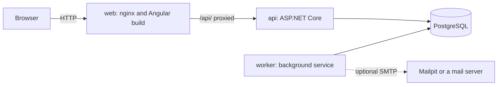

# BranchBooking

A branch appointment booking system in the style of a retail bank: customers choose an appointment type and a branch, pick a free time, get a booking reference and a confirmation, and can later look the booking up by that reference to move or cancel it. Built as a demo of a Capitec-style experience.

- **Frontend:** Angular with Tailwind CSS, mobile first, WCAG 2.2 AA target.
- **Backend:** ASP.NET Core Web API on .NET 10, EF Core 10, PostgreSQL 16, plus a background Worker for notifications.
- **Run it** with Docker (optional) or with local tools only.

> **This is not Capitec's system and is not affiliated with Capitec.** It borrows the look and feel (colours, layout) that were asked for; it contains no Capitec logo, image or font. The sample branches are demo data, not real branches. Messages are simulated by default: nothing is emailed unless you configure an SMTP server, and the bundled Mailpit inbox only shows the emails on your machine.

## What it does

- Book: choose an appointment type (open an account, collect a card, apply for a loan), a branch, a date and time, and enter your details. The time you see is always the branch's clock.
- Confirmation: your booking reference (for example `BK-7H2QX-M9RTD`), the details, copy, print and add-to-calendar.
- Manage: look a booking up by its reference; see its status and the messages sent about it; move it to another time; cancel it. No account or password: **the reference is the credential**.
- Messages: a confirmation, a cancellation or reschedule notice and a reminder about a day before. The default channel is simulated and shown in the app as a demo; email through SMTP is configuration only, and Mailpit (native executable or compose profile) shows those emails locally.
- Safe by default: two customers can never hold the same last place; limits on how fast one address can create bookings or guess references; errors have stable codes; nothing sensitive is logged.

## How it works



| Part | Folder | What it does |
|---|---|---|
| web | `frontend/branchbooking-web` | The Angular app, served by nginx, which also forwards `/api/` to the API so the browser sees one origin |
| api | `src/BranchBooking.Api` | The HTTP API under `/api/v1`: branches, availability, create, look up, cancel and reschedule bookings, messages, health |
| worker | `src/BranchBooking.Worker` | Sends queued notifications and schedules reminders; the API never sends anything itself |
| domain, application, infrastructure | `src/BranchBooking.*` | Business rules, use cases, EF Core and PostgreSQL; the layering is enforced by a test |
| tests | `tests/`, `frontend/branchbooking-web/src/**/*.spec.ts`, `e2e/` | Unit, database-backed integration, frontend unit and end-to-end browser tests |

Notifications are written to the database in the same transaction as the booking change (an outbox), then sent by the Worker, so a booking never fails because an email could not be sent.

## Quick start

Pick one path. Docker is optional.

| | Docker path | Manual path |
|---|---|---|
| Needs | Docker with Compose v2 | .NET SDK 10, Node 22.12 or newer, PostgreSQL 16 |
| Start | `docker compose up --build` | `scripts/run-manual.sh` (or `.ps1`) |
| Test emails with Mailpit | `docker compose --profile mail up --build` with `NOTIFICATIONS_CHANNEL=Smtp` | `scripts/run-manual.sh --mailpit` or `./scripts/run-manual.ps1 -Mailpit` |
| Open | http://localhost:8080 | http://localhost:4200 |
| Mailpit inbox | http://localhost:8025 | http://localhost:8025 |

For Mailpit installation, SMTP settings and an email test walkthrough, see [Mailpit without Docker](#mailpit-without-docker).

### Running with Docker (optional)

```bash
cp .env.example .env            # then set your own POSTGRES_PASSWORD (avoid ; = and spaces)
docker compose up --build -d
docker compose ps               # db, api and web should be healthy; worker running
scripts/verify-foundation.sh    # PowerShell: scripts/verify-foundation.ps1
```

Open http://localhost:8080. Stop with `docker compose down`; add `-v` to also delete the database volume. The demo stack applies database migrations and loads the sample branches itself on first start.

| Service | Port on your machine | Notes |
|---|---|---|
| web (nginx and Angular) | 8080 (`WEB_PORT`) | proxies `/api/` to the API |
| api | 127.0.0.1:5080 (`API_PORT`) | `/api/v1/health`, `/api/v1/health/ready` |
| db (PostgreSQL 16) | 127.0.0.1:5432 (`POSTGRES_PORT`) | data in the `db-data` volume |
| worker | none | sends messages, queues reminders |

### Running without Docker

1. Install .NET SDK 10, Node 22.12 or newer, and PostgreSQL 16.
2. Create the database and set the connection string: `docs/engineering/local-postgres.md`.
3. Start everything: `scripts/run-manual.sh` (Linux, macOS) or `scripts/run-manual.ps1` (Windows PowerShell). Or by hand, in three terminals:
   - `dotnet run --project src/BranchBooking.Api --launch-profile http`
   - `dotnet run --project src/BranchBooking.Worker`
   - `cd frontend/branchbooking-web && npm ci && npm start`
4. Open http://localhost:4200. Check it with `scripts/verify-foundation.sh http://localhost:5080 http://localhost:4200`.

To receive test emails in a local inbox, install native Mailpit and use `scripts/run-manual.sh --mailpit` or `./scripts/run-manual.ps1 -Mailpit` instead of the plain launcher. The launcher starts the notification Worker as well as the API and frontend. Full setup and verification steps follow below.

### Mailpit without Docker

Mailpit also runs as a native executable on Windows, macOS and Linux. Download the archive for your OS and CPU from the [official Mailpit releases](https://github.com/axllent/mailpit/releases), verify its SHA-256 against the digest shown beside that release asset, extract it, and put `mailpit` (`mailpit.exe` on Windows) on your `PATH`. Check with `mailpit version`. On macOS, `brew install mailpit` is another supported option.

For example, on Windows, extract `mailpit.exe` to `C:\Tools\Mailpit`, then add it to the current PowerShell session:

```powershell
$env:Path += ';C:\Tools\Mailpit'
mailpit version
```

On Linux, make the extracted binary executable (`chmod +x mailpit`) and put its directory on `PATH`, for example `export PATH="$HOME/tools/mailpit:$PATH"` when it is saved as `~/tools/mailpit/mailpit`. Run all launcher commands below from the repository root.

With local PostgreSQL running, set the database connection string in the terminal that will launch the app. Both the API and notification Worker need it; their user-secret stores are separate.

Linux/macOS:

```bash
export ConnectionStrings__BranchBooking='Host=localhost;Port=5432;Database=branchbooking;Username=branchbooking;Password=<YOUR-LOCAL-PASSWORD>'
scripts/run-manual.sh --mailpit
```

Windows PowerShell:

```powershell
$env:ConnectionStrings__BranchBooking = 'Host=localhost;Port=5432;Database=branchbooking;Username=branchbooking;Password=<YOUR-LOCAL-PASSWORD>'
./scripts/run-manual.ps1 -Mailpit
```

This starts native Mailpit, the API, the notification Worker and Angular. The Mailpit option configures the Worker for SMTP at `127.0.0.1:1025`, no TLS or authentication, with `noreply@branchbooking.example` as the sender and `http://localhost:4200` as the address in email links. Both Mailpit ports bind to loopback. Without the option, the launcher uses your existing notification settings (simulated by default). Stop the launcher with Ctrl+C to stop the processes it started.

To test delivery:

1. Open the app at http://localhost:4200 and book a future appointment with a fake address such as `customer@example.com`.
2. Open Mailpit at http://localhost:8025. Within the Worker's default 10-second polling interval, the confirmation should appear. Check the booking reference and appointment details in the email.
3. Look the booking up in the app, move it, then cancel it. Check Mailpit for the corresponding messages. Mailpit captures them locally; it does not deliver them to the customer's real inbox.
4. If nothing arrives, check that the Worker is running with `Notifications__Channel=Smtp`. The app's message panel can show its status; `network_error` usually means Mailpit is not listening on the configured address.

**Already running Mailpit?** Leave off `--mailpit` / `-Mailpit` so the launcher does not try to start a second copy. Set the following in the launch terminal first (use `$env:NAME = 'value'` in PowerShell):

```bash
export Notifications__Channel=Smtp
export Notifications__PublicBaseUrl=http://localhost:4200
export Notifications__Smtp__Host=127.0.0.1
export Notifications__Smtp__Port=1025
export Notifications__Smtp__Security=None
export Notifications__Smtp__Username=
export Notifications__Smtp__Password=
export Notifications__Smtp__SenderEmail=noreply@branchbooking.example
export Notifications__Smtp__SenderName=BranchBooking
scripts/run-manual.sh
```

You can start Mailpit yourself in a separate terminal with:

```bash
mailpit --listen 127.0.0.1:8025 --smtp 127.0.0.1:1025
```

The `.env` file and `SMTP_*` / `NOTIFICATIONS_CHANNEL` variables configure Docker Compose only. Native .NET processes read the `Notifications__...` variables above, application settings or user-secrets. Do not use `mailpit` as the SMTP hostname for a native Worker; that name belongs to the Docker network. This local, unencrypted configuration is for the Mailpit inbox; use TLS and authentication for a real SMTP provider.

| Problem | What to check |
|---|---|
| `mailpit` is not found | Run `mailpit version` in the same terminal as the launcher; add the extracted executable's directory to that terminal's `PATH` |
| Port 1025 or 8025 is already in use | If your Mailpit instance is already running, use the existing-instance instructions above and omit the Mailpit launcher option |
| The inbox is empty | Check the Worker's console for startup or SMTP errors, confirm `Notifications__Channel=Smtp`, and allow at least 10 seconds after booking |
| The Worker has no database connection | Export `ConnectionStrings__BranchBooking` before launching, or configure user-secrets separately for both API and Worker |

## Using the app

1. **Book** at `/book`: four steps (type, branch, date and time, your details). If someone else takes your time first you are sent back to choose another.
2. **Confirmation** at `/confirmation`: keep the reference. The page forgets the booking when you reload, on purpose (see Security and privacy).
3. **Manage** at `/manage`: type the reference (case, spaces and dashes do not matter). Move or cancel while the change window is open. Messages appear in the panel; with the simulated channel each shows "Demo message. Nothing was emailed." and can be read.

## API

Full guide with request and response examples and every error code: `docs/api/README.md`. Summary (all under `/api/v1`):

| Method and path | Purpose |
|---|---|
| `GET /appointment-types` | what can be booked |
| `GET /branches` | branches with opening hours and time zone |
| `GET /branches/{id}/availability?date=YYYY-MM-DD` | free times for a branch-local date |
| `POST /bookings` | create a booking; returns the reference |
| `GET /bookings/{reference}` | look a booking up (contact details are masked) |
| `POST /bookings/{reference}/cancel` | cancel, with an optional reason |
| `POST /bookings/{reference}/reschedule` | move to another time |
| `GET /bookings/{reference}/messages` | the messages produced for a booking |
| `GET /health`, `GET /health/ready` | liveness and readiness |

Errors are RFC 9457 problem details with a stable `code` and a `correlationId`.

## Configuration reference

Settings reach the applications in two ways: **environment variables** (set in `.env` for compose, read by `docker-compose.yml`), and **application settings** (`appsettings.json` or environment variables with `__` for `:`, for example `BookingPolicy__MaxAdvanceDays`). `.env` is never committed.

### Environment variables (`.env`)

| Variable | Default | Used by | Meaning |
|---|---|---|---|
| `POSTGRES_PASSWORD` | none, required | db, api, worker | Database password. Choose your own; avoid `;`, `=` and spaces |
| `POSTGRES_USER` | `branchbooking` | db, api, worker | Database user |
| `POSTGRES_DB` | `branchbooking` | db, api, worker | Database name |
| `POSTGRES_PORT` | `5432` | db | Host port, bound to 127.0.0.1 |
| `API_PORT` | `5080` | api | Host port, bound to 127.0.0.1 |
| `WEB_PORT` | `8080` | web | Host port |
| `NOTIFICATIONS_CHANNEL` | `Simulated` | worker | `Simulated` sends nothing and keeps the text for the demo; `Smtp` sends email through the server below |
| `PUBLIC_BASE_URL` | `http://localhost:8080` | worker | The address customers use; the base of the link in messages |
| `SMTP_HOST` | `mailpit` | worker | SMTP server name; `mailpit` is the demo inbox started by `docker compose --profile mail up -d` |
| `SMTP_PORT` | `1025` | worker | Mailpit listens on 1025; a real server usually 587 (or 465) |
| `SMTP_SECURITY` | `None` | worker | `None` (Mailpit only), `StartTls` or `SslOnConnect` |
| `SMTP_USERNAME` | empty | worker | Leave empty for Mailpit; a real server's login. Needs `StartTls` or `SslOnConnect` |
| `SMTP_PASSWORD` | empty | worker | The matching password; never commit it |
| `SMTP_SENDER_EMAIL` | `noreply@branchbooking.example` | worker | The From address; a real server usually requires one you may send as |
| `SMTP_SENDER_NAME` | `BranchBooking` | worker | Sender display name |
| `REMINDERS_ENABLED` | `true` | worker | Turns reminder scheduling on or off |
| `REMINDERS_GAP_HOURS` | `4` | worker | A booking must be left alone this long before it is reminded (0 for a demo) |
| `BRANCHBOOKING_TEST_CONNECTION` | unset | tests | A database whose name ends in `_test`; without it database tests are skipped |

For releases (`deploy/.env.release.example`): `BRANCHBOOKING_VERSION` (the release to run, without the `v`), `IMAGE_OWNER` (the lower-case GitHub owner of the images), `MIGRATE_ON_STARTUP` (`true` applies migrations when the API starts; default `false`) and `BRAND_NAME` (the name in message footers, default `BranchBooking`).

For the browser tests: `E2E_WEB_PORT` (18080), `E2E_API_PORT` (15080), `E2E_POSTGRES_PORT` (15432) and `E2E_BASE_URL` (what the tests open; the script sets it).

### Application settings

| Setting | Default | Meaning |
|---|---|---|
| `ConnectionStrings:BranchBooking` | none | PostgreSQL connection string (compose builds it from the `POSTGRES_*` variables) |
| `Database:MigrateOnStartup` | `false` (`true` in Development and in the demo compose) | Apply pending migrations when the API starts |
| `BookingPolicy:MinimumNoticeMinutes` | `60` | A booking or move must start at least this far ahead |
| `BookingPolicy:MaxAdvanceDays` | `30` | How far ahead customers may book (branch-local days) |
| `BookingPolicy:ChangeCutoffHours` | `2` | Cancel and move are allowed until this long before the start |
| `BookingPolicy:MaxReschedules` | `3` | How many times one booking may be moved |
| `RateLimiting:Enabled` | `true` | Turns the limits on or off |
| `RateLimiting:WritePermitsPerMinute` | `10` | Create, cancel and move requests per client address per minute |
| `RateLimiting:LookupPermitsPerMinute` | `30` | Lookups by reference per client address per minute |
| `RateLimiting:GlobalPermitsPerMinute` | `300` | All requests per client address per minute (health checks excluded) |
| `Cors:AllowedOrigins` | empty | Exact origins allowed to call the API from a browser; empty is right when the web app is served from the same origin |
| `ASPNETCORE_FORWARDEDHEADERS_ENABLED` | `true` in compose, unset otherwise | Trust the proxy's `X-Forwarded-For` so limits see the customer's address; only safe when the API port is not published |
| `Notifications:Channel` | `Simulated` | `Simulated` or `Smtp` |
| `Notifications:BrandName` | `BranchBooking` | Named in message footers; not a real institution's name by default |
| `Notifications:PublicBaseUrl` | `http://localhost:8080` | Base of the link in messages |
| `Notifications:ManagePath` | `/manage` | Path of the manage page; must match the web route |
| `Notifications:BatchSize` | `20` | Messages claimed per pass |
| `Notifications:PollSeconds` | `10` | Seconds between passes |
| `Notifications:MaxAttempts` | `5` | Attempts before a message is marked failed |
| `Notifications:RetryBaseSeconds` | `30` | Delay after the first failure; doubles each time |
| `Notifications:RetryMaxSeconds` | `3600` | Longest retry delay |
| `Notifications:LeaseSeconds` | `300` | How long a claimed message is reserved; must outlast a whole batch of sends |
| `Notifications:Smtp:Host` | none | See `SMTP_HOST` |
| `Notifications:Smtp:Port` | `587` | See `SMTP_PORT` (compose sets 1025) |
| `Notifications:Smtp:Security` | `StartTls` | See `SMTP_SECURITY` (compose sets `None`) |
| `Notifications:Smtp:Username` | empty | See `SMTP_USERNAME` |
| `Notifications:Smtp:Password` | empty | See `SMTP_PASSWORD` |
| `Notifications:Smtp:SenderEmail` | none | See `SMTP_SENDER_EMAIL` |
| `Notifications:Smtp:SenderName` | `BranchBooking` | See `SMTP_SENDER_NAME` |
| `Notifications:Smtp:TimeoutSeconds` | `10` | For the whole send: connect, log in, transmit |
| `Notifications:Reminders:Enabled` | `true` | Reminder scheduling |
| `Notifications:Reminders:LeadHours` | `24` | A booking is reminded once its appointment is this close |
| `Notifications:Reminders:MinimumLeadMinutes` | `60` | No reminder when the appointment is this close or closer |
| `Notifications:Reminders:MinimumGapHours` | `4` | See `REMINDERS_GAP_HOURS` |
| `Notifications:Reminders:ScanIntervalSeconds` | `60` | How often the Worker looks for bookings to remind |
| `Notifications:Reminders:BatchSize` | `100` | Bookings handled per scan |

The Worker and the API refuse to start with invalid values and name the section at fault, without printing any secret. The notifications settings and the Mailpit and SMTP set-up steps are in `docs/engineering/notifications.md`.

### Business assumptions that are not confirmed

These are the planner's defaults, not the bank's policy. Each is a setting above; confirm or change them before real use.

| Assumption | Setting |
|---|---|
| 60 minutes' notice, 30-day booking window | `BookingPolicy:MinimumNoticeMinutes`, `BookingPolicy:MaxAdvanceDays` |
| Cancel or move until 2 hours before; at most 3 moves | `BookingPolicy:ChangeCutoffHours`, `BookingPolicy:MaxReschedules` |
| Reminder 24 hours ahead, not within 60 minutes, not within 4 hours of the booking | `Notifications:Reminders:*` |
| The branch list is five demo branches | the seed data (`docs/engineering/database-migrations.md`) |
| How long booking and message data is kept (POPIA) | not implemented: no deletion job exists |

## Testing

Backend (xUnit). Database tests need a disposable database whose name ends in `_test` (the tests delete all rows in it and refuse any other name):

```bash
dotnet test BranchBooking.slnx -c Release                                  # database tests are skipped without the variable below
export BRANCHBOOKING_TEST_CONNECTION="Host=localhost;Port=5432;Database=branchbooking_test;Username=branchbooking;Password=<YOUR-PASSWORD>"
dotnet test BranchBooking.slnx -c Release                                  # now nothing is skipped
```

Frontend:

```bash
cd frontend/branchbooking-web && npm ci && npm run lint && npm run test:ci && npm run build
```

End to end (real browser, real stack in containers, own ports, own database volume):

```bash
scripts/e2e.sh        # see docs/engineering/e2e.md for the manual path
```

No local tools? Run the backend and frontend tests inside containers:

```bash
docker run --rm -v "$PWD":/src -w /src mcr.microsoft.com/dotnet/sdk:10.0 dotnet test BranchBooking.slnx -c Release
docker run --rm -v "$PWD/frontend/branchbooking-web":/app -w /app node:22-alpine sh -c "npm ci && npm run test:ci && npm run lint"
```

## Releases and deployment

Every pull request runs the CI pipeline (build with warnings as errors, unit and database tests with nothing skipped, migration drift check, dependency audits, frontend lint, tests and build, script and workflow checks), and the browser tests. Merge to `main` only when the jobs are green. See `docs/engineering/ci.md` and `docs/engineering/e2e.md`.

Pushing a version tag (`v0.1.0`, or `v0.1.0-rc.1` for a pre-release) tests that commit again, builds and scans the three images, publishes them to `ghcr.io/<owner>/branchbooking-api`, `-worker` and `-web`, and creates a GitHub release with a migration bundle and a compose file for one host. How to cut, deploy, upgrade and roll back: `docs/engineering/releasing.md`. Changes per version: `CHANGELOG.md`.

The release compose file does not terminate TLS. Put HTTPS in front of the web port before exposing it.

## Security and privacy

- **The booking reference is the only credential.** Anyone with it can view, move and cancel that booking. The web app keeps it in memory only: never in a URL, browser storage, history or the page title, and a reload forgets it. The API limits lookups per client address (`RateLimiting:LookupPermitsPerMinute`) so guessing is impractical, and never logs a reference.
- **Personal data.** Name, email and phone are stored with the booking, shown masked on look-up, and not written to logs. The simulated channel stores message text (which contains the name and reference) for the demo; real channels store none. No retention or deletion job exists yet, and the consent and privacy wording in the app has not been reviewed by a lawyer: do both before real customers use it (POPIA).
- **No secrets in the repository.** Passwords and API keys come from `.env`, environment variables or `dotnet user-secrets`. CI generates throwaway database passwords per run. `.env` is git-ignored.
- **Web hardening.** nginx sends a Content-Security-Policy, `X-Content-Type-Options`, `X-Frame-Options` and a referrer policy; the API's CORS allows no origin unless listed (no wildcards). Containers run as non-root.
- **Supply chain.** NuGet and npm audits fail CI on known vulnerabilities; images are scanned and carry build provenance and an SBOM; Dependabot proposes updates weekly.
- **Brand.** Nothing here may present itself as Capitec's own service. Keep the "demo" wording and the neutral brand name unless the owner approves otherwise.

## Troubleshooting

| Symptom | Cause and fix |
|---|---|
| `docker compose` says "Set POSTGRES_PASSWORD in .env" | Copy `.env.example` to `.env` and set a password |
| The API cannot connect to the database | The password contains `;`, `=` or a space; choose another, or the `db` service is not healthy (`docker compose logs db`) |
| "port is already allocated" | Change `WEB_PORT`, `API_PORT` or `POSTGRES_PORT` in `.env` |
| The footer says **Unavailable**, or the web shows 502 | The API is not healthy: `docker compose logs api`. Readiness (`/api/v1/health/ready`) fails when the database is unreachable or the schema is missing: check `Database:MigrateOnStartup` |
| Web restarts with `host not found in upstream "api"` | Rebuild web with `docker compose up --build -d web` to pick up the nginx Docker DNS configuration. Web now stays running during API outages and resolves recreated API containers. Check `docker compose ps -a` and `docker compose logs --tail=80 api` for the underlying API failure; API requests return 502 until it recovers |
| Backend tests are reported as skipped | `BRANCHBOOKING_TEST_CONNECTION` is not set. It must name a database ending in `_test` |
| `dotnet ef` is not found | Run `dotnet tool restore` (the tool is pinned in `.config/dotnet-tools.json`) |
| Messages stay "Waiting to send" | The Worker is not running, or `Notifications:PollSeconds` is large. With `Smtp`, a missing or inconsistent setting stops the Worker at start and the error names `Notifications:Smtp`. If the Worker runs but messages show `Failed` or keep retrying with `network_error`, Mailpit is not running: use the native Mailpit steps above, or `docker compose --profile mail up -d` |
| The Worker logs a missing time zone | The image has no time zone data (`Africa/Johannesburg`); the release image check catches this |
| Everyone gets "Too many attempts" | The API sees one address (the proxy's). Set `ASPNETCORE_FORWARDEDHEADERS_ENABLED=true` and do not publish the API port |
| Times look wrong | Times follow the branch's time zone, not the device's. If a branch's time is wrong, check the time zone data and the branch's `timeZoneId` |
| I reloaded and the confirmation is gone | By design: look the booking up with its reference on **Manage booking** |
| **Copy reference** does nothing | Browsers allow the clipboard only on HTTPS or localhost. The page then asks you to copy by hand |
| The Docker web build cannot find `dist/.../browser` | The Angular output folder differs: fix the `COPY --from=build` path in `docker/web.Dockerfile` |
| A browser test says "No open appointment time" | The seed data has no opening hours in the booking window |
| `check-docs` fails in CI | A variable, link, section or document is missing from the documentation: the message names it |

## Project layout

```text
BranchBooking.slnx            solution
src/                          Domain, Application, Infrastructure, Api, Worker
tests/                        UnitTests, IntegrationTests
frontend/branchbooking-web/   Angular app (Tailwind v4)
e2e/                          Playwright browser tests
docker/                       Dockerfiles and nginx configuration
deploy/                       compose file and settings template for a release
scripts/                      run, verify, e2e and CI scripts
docs/                         guides (docs/README.md is the index)
.github/                      workflows, Dependabot, pull request template
```

## Documentation

The index is `docs/README.md`: API guide, notifications, database migrations, local PostgreSQL, CI, end-to-end tests, releasing, toolchain, branching and commits.

## License

No license has been chosen. Until one is added, the code is all rights reserved by its authors; add a `LICENSE` file before sharing it.
